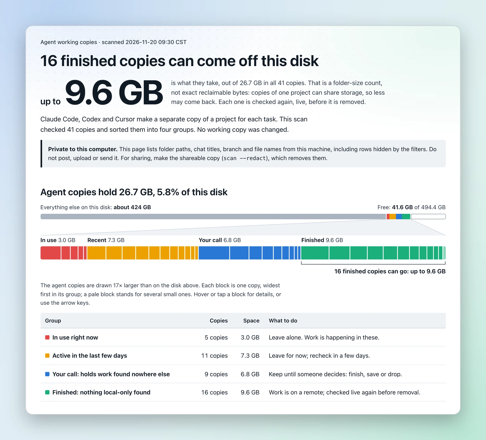
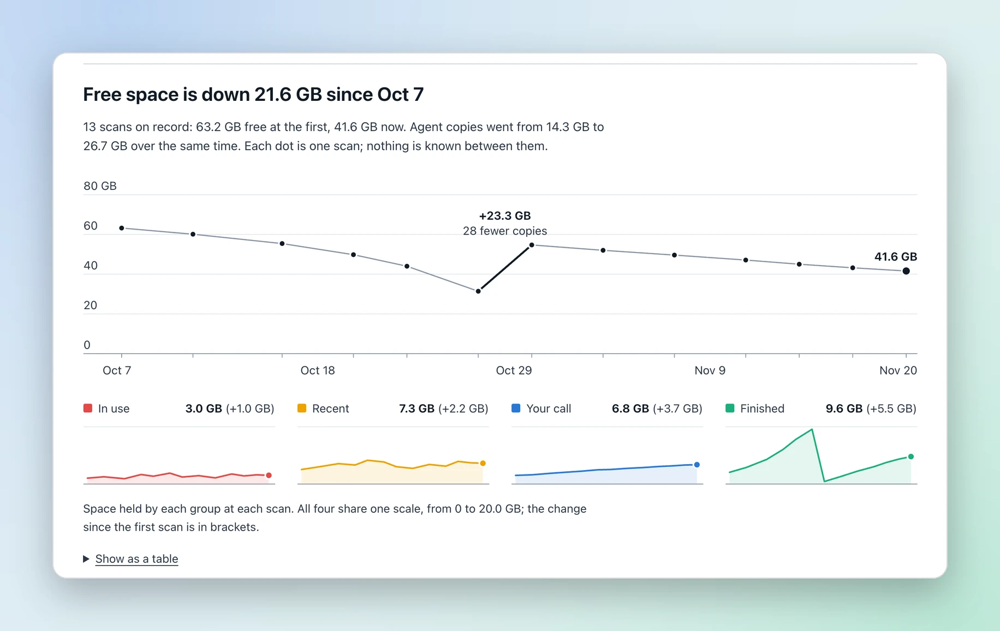
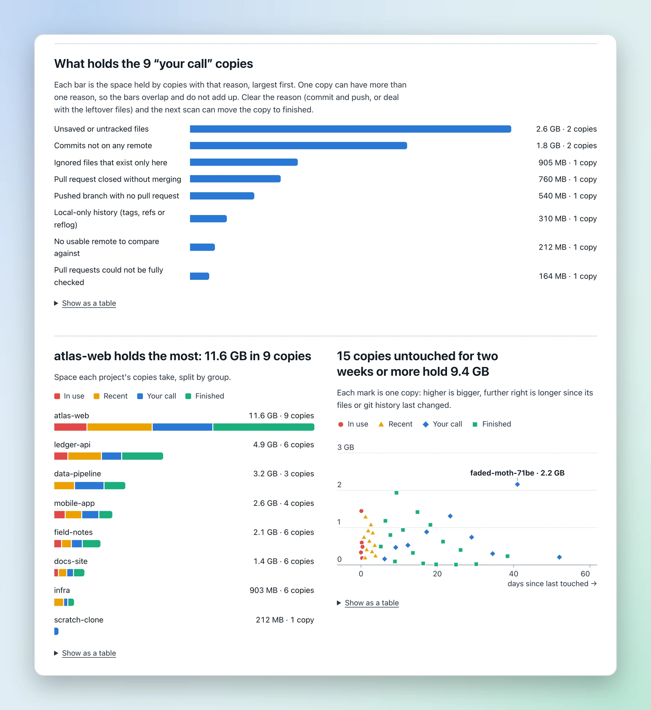
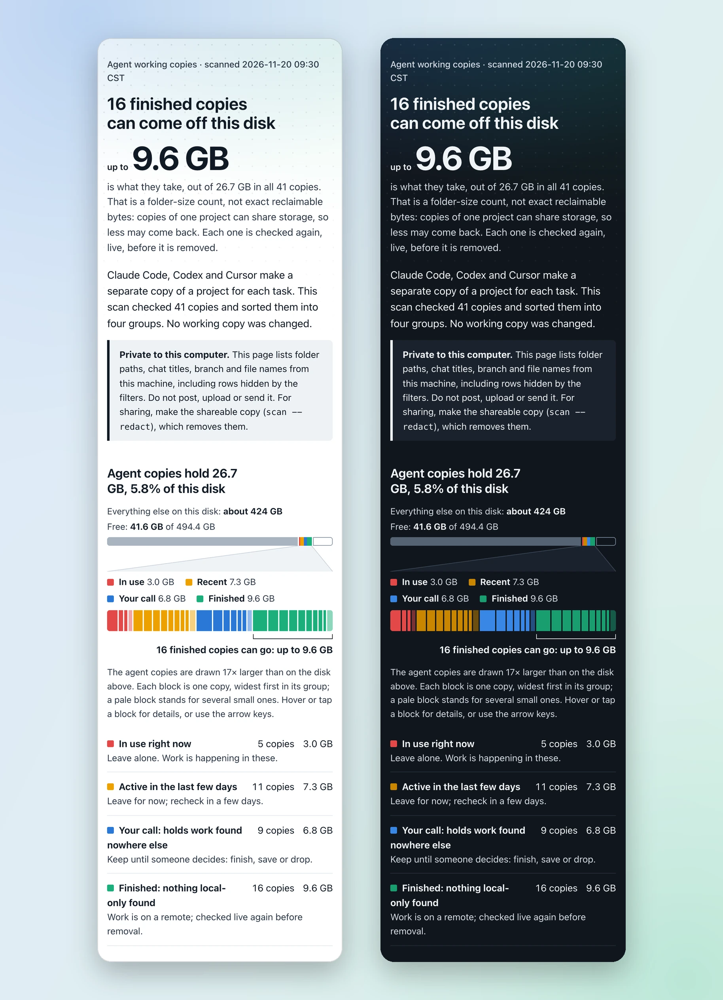

# agent-copy-sort

<div align="center">
<picture>
  <source media="(prefers-color-scheme: dark)" srcset="docs/img/hero-dark.webp">
  
</picture>
</div>

<div align="center">

[](https://github.com/BTCElectrician/agent-copy-sort/actions/workflows/test.yml)
[](https://github.com/BTCElectrician/agent-copy-sort/releases)
[](LICENSE)

</div>

Find the copies of your code that Claude Code, Codex and Cursor leave behind,
see which ones still hold work, and remove only the ones that are provably
finished, after you say yes.

<div align="center">
<h3>Quick install</h3>

```bash
git clone https://github.com/BTCElectrician/agent-copy-sort.git ~/.claude/skills/agent-copy-sort
```

For Codex, clone into `~/.agents/skills/agent-copy-sort` instead.

**[Try the live demo](https://btcelectrician.github.io/agent-copy-sort/)** first if you like. Nothing to install, and every name and number in it is invented.

</div>

## TL;DR

**The problem.** Coding agents give every task its own copy of your project
so parallel work does not collide: a git worktree under `.claude/worktrees/`,
`~/.codex/worktrees/` or `~/.cursor/worktrees/`, or a full clone in a temp
folder. Nothing cleans them up. After a few weeks you can have dozens of
copies, each with its own `node_modules` or virtual environment, and the disk
fills.

Deleting them by hand is risky. Some still hold work that exists nowhere
else: a commit that was never pushed, an untracked file, a `.env`, a branch
whose pull request was closed. Some are being used by an agent right now.
From the outside, a finished copy and an important one look the same.

**The solution.** This skill scans every copy without changing anything,
sorts each one into one of four groups, and writes a page that says what can
go and how much space you get back. It removes only the copies you approve,
and only the ones it can still prove are finished at that moment.

### Why use it

| What you get | What that means in practice |
| --- | --- |
| **It knows what is still in use** | It checks whether a program has its working folder or an open file inside a copy, and whether the chat that made the copy was active recently. |
| **It finds work that exists nowhere else** | Unsaved, untracked and ignored files, unpushed commits and tags, and history kept only by a reflog or `ORIG_HEAD` all keep a copy out of "finished". |
| **It proves "finished" before it removes** | The work has to be on the live remote (`git ls-remote`), checked again right before removal and once more after the slow step. There is no force option. |
| **One page answers the question** | The page opens with what can go and up to how much space that is, then shows why every other copy is waiting. |
| **Private by default** | The page, the plan and the scan history stay on your computer in a folder only you can read. The page makes no network requests. `--redact` writes a copy with paths, names and ids removed for sharing. |
| **Nothing to install but the skill** | Python standard library only. It needs Python 3.9 or newer and git. |

## Quick example

Ask your agent something like "my disk is full of agent worktrees, which
ones can go?" and the skill should trigger on its own. To call it
explicitly, use `/agent-copy-sort` in Claude Code or mention
`$agent-copy-sort` in Codex.

You can also run the script yourself:

```bash
# 1. Scan. Writes a private plan and page under ~/.local/state/agent-copy-sort
python3 ~/.claude/skills/agent-copy-sort/scripts/agent_copy_sort.py scan

# 2. Open the page it prints, read the four groups, pick finished copies.

# 3. Dry run, then the real removal, for the ids you chose
python3 ~/.claude/skills/agent-copy-sort/scripts/agent_copy_sort.py remove \
  --plan ~/.local/state/agent-copy-sort/scan-<stamp>.json --ids <id> <id>
python3 ~/.claude/skills/agent-copy-sort/scripts/agent_copy_sort.py remove \
  --plan ~/.local/state/agent-copy-sort/scan-<stamp>.json --ids <id> <id> --confirm
```

The scan prints a summary like this (abbreviated; numbers are illustrative):

```
23 copies: inuse 2 (1.4 GB), recent 5 (3.0 GB), decide 7 (6.2 GB), done 9 (11.8 GB)
plan: ~/.local/state/agent-copy-sort/scan-20260101-093000-1a2b3c.json
page (private, open locally): ~/.local/state/agent-copy-sort/report-20260101-093000-1a2b3c.html
```

## The page

Every scan writes one page. It answers one question first: what can I safely
remove, and how much space do I get back? Then it shows the disk drawn to
scale with the agent copies magnified (each block is one copy), free space at
each past scan, what is holding the copies that need your decision, which
projects pile up copies, and every copy in a table you can filter.

<div align="center">
<picture>
  <source media="(prefers-color-scheme: dark)" srcset="docs/img/trend-dark.webp">
  
</picture>
</div>


<div align="center">
<picture>
  <source media="(prefers-color-scheme: dark)" srcset="docs/img/detail-dark.webp">
  
</picture>
</div>

It is one self-contained file. It loads no fonts, scripts or images from
anywhere and makes no network requests. It works in light and dark, on a
phone and on a desktop, with a keyboard, and every chart has a table view.

<div align="center">
<picture>
  <source media="(prefers-color-scheme: dark)" srcset="docs/img/phones-dark.webp">
  
</picture>
</div>

The pictures above are the demo page: every project, name, path and number in
them is invented ([`demo/demo-scan.json`](demo/demo-scan.json)). Render it
yourself, without scanning anything:

```bash
python3 demo/render_demo.py --redact
```

The live demo is that same page with one line added at the top
(`docs/index.html`, rebuilt with `python3 demo/render_demo.py --site`; a test
fails if it falls behind the tool).

Two things the page is careful about. Sizes are folder sizes, not exact
reclaimable bytes: copies of one project can share storage, so the page says
"up to". And the free-space chart draws only scans that were actually run,
one dot each, from a small private history file (numbers only, at most 400
scans, `--no-history` turns it off); nothing is assumed between them.

## How it sorts

| Group | What it means | What to do |
| --- | --- | --- |
| **In use** | A program has its working folder or an open file inside the copy, or its chat was active in the last day and it has unsaved files or an open pull request. | Leave alone. |
| **Recently active** | Its chat or its git history moved in the last few days (4 by default). | Leave for now and scan again later. |
| **Your call** | It holds work found nowhere else, or a check failed or did not finish. | Finish it, save it or drop it yourself. |
| **Finished** | Nothing local-only was found and its work is on a remote. | Safe to approve for removal. |

Anything uncertain lands in "your call", never in "finished". The page says
why for each copy.

## How it compares

| | agent-copy-sort | Deleting folders by hand | `git worktree prune` | `git worktree remove` |
| --- | --- | --- | --- | --- |
| Finds copies across Claude Code, Codex, Cursor and temp folders | Yes | You hunt for them | No. One repository at a time | No. You name each one |
| Knows a copy is in use right now | Yes | No | No | No |
| Catches unpushed commits and local-only history | Yes | No | No | No |
| Catches unsaved and untracked files | Yes | No | No | Yes, it refuses unless forced |
| Catches ignored files that exist only there | Yes | No | No | No |
| What it removes | Only copies proven finished, after your yes | Whatever you delete | Only records of worktrees whose folder is already gone | The worktree you name |

## What it will not do

- **It removes only fully safe copies.** Only copies in "finished" can be
  removed: nothing local-only found, and the work confirmed on the live
  remote. There is no force option. If you want to remove a "your call"
  copy, finish it properly (commit and push, or delete the specific leftover
  files yourself) and scan again.
- **Nothing may be writing to a copy while it is removed.** Stop the agent
  or program working there first. The checks before and after the slow
  steps catch most changes, but a write that lands between the last check
  and the deletion can be lost.
- **Removing a worktree is permanent; a clone goes to the Trash.** Linked
  worktrees are removed with plain `git worktree remove` (never `--force`);
  the folder does not go to the Trash, and its branch stays in the
  repository. Standalone clones are moved to the Trash (macOS `trash` or
  Finder, Linux `gio trash`), so you can still recover them there.
- It never removes your original repositories: anything found under your
  usual project folders or a `--root` you name is protected, as are main
  checkouts and repositories other copies depend on.
- It does not upload anything. The page, the plan and the scan history stay
  on your computer, in a folder only you can read, and the page itself makes
  no network requests. With `gh` installed it asks GitHub about pull
  requests; `--no-github` turns that off.
- It does not find copies outside the usual agent folders and temp folders.
  `--root` and `--temp-root` add more places to look.

## Install

**Claude Code**

```bash
git clone https://github.com/BTCElectrician/agent-copy-sort.git ~/.claude/skills/agent-copy-sort
```

Claude Code picks up new skills without a restart; if `~/.claude/skills` did
not exist when the session started, run `/reload-skills`.

**Codex**

```bash
git clone https://github.com/BTCElectrician/agent-copy-sort.git ~/.agents/skills/agent-copy-sort
```

Codex still reads the older `~/.codex/skills`, but that location is
deprecated. If Codex does not list the skill, restart it.

To update later, run `git pull` in the folder you cloned into.

It is written for Claude Code and Codex. Because it uses the open
[Agent Skills](https://agentskills.io/specification) format (`SKILL.md`),
other tools that read that format can load it too, though it has not been
exercised there.

### Platforms

Tested on macOS and Ubuntu Linux (GitHub Actions `macos-latest` and
`ubuntu-latest`) with the system Python 3 and git. It needs Python 3.9 or
newer and git, and nothing else outside the standard library. `gh`, `lsof`
and `tmutil` are used when present. Windows is not supported.

## Commands

[`SKILL.md`](SKILL.md) is the file the agent reads; it has the full
procedure, every option, and the complete list of what counts as
local-only. The short version:

**`scan`** changes no working copy.

| Option | What it does |
| --- | --- |
| `--out <folder>` | Where the plan and page go. Default `~/.local/state/agent-copy-sort`, created private. |
| `--root <folder>` | An extra folder that holds repositories. Repeatable. Repositories found there are originals and never removable. |
| `--temp-root <folder>` | A temp folder to search for clones. Repeatable. |
| `--recent-days N` | How many days count as "recently active". Default 4. |
| `--time-limit S` | A best-effort time budget in seconds. Default 300. |
| `--no-github` | Skip pull-request lookups. |
| `--redact` | Also write a shareable page without paths, names or ids. |
| `--no-history` | Do not read or add to the private scan history. |
| `--allow-caches` | Treat the named rebuildable cache folders as safe to remove. Off by default; see `SKILL.md`. |
| `--accept-unreadable NAME` | Linux only: a program name whose hidden details you accept as not working in these copies. |

**`remove`** acts on one scan plan and the ids you approved.

| Option | What it does |
| --- | --- |
| `--plan <file>` | The `scan-*.json` plan the ids come from. Required. |
| `--ids <id> ...` | The copy ids to remove. Required. |
| `--confirm` | Actually act. Without it, a dry run. |
| `--time-limit S` | A best-effort time budget in seconds. Default 600. |
| `--no-github` | Skip pull-request lookups. |
| `--temp-root <folder>` | A temp folder whose clones count as copies. Repeatable. If `scan` was given one, give `remove` the same one. |
| `--recent-days N` | How many days count as "recently active". Default 4, or the plan's value when that is larger. |
| `--root <folder>` | An extra folder that holds original repositories. Repeatable. The ones named at scan time are kept as well. |
| `--allow-caches` | Rebuildable caches do not block removal. The plan must have been scanned with it too. |
| `--accept-unreadable NAME` | Linux only, as for `scan`. |

`remove` takes its settings from this computer and its own command line,
never from the plan file. A plan is only the list of copies to check again, so
editing one cannot move the folders it protects or relabel a project as a
copy. A plan made under a different home folder is refused: scan again.

## Troubleshooting

| What you see | What it means | What to do |
| --- | --- | --- |
| Nothing is in "finished" | Every copy is in use, was active recently, or holds something that exists only there. | Read "What holds the your-call copies" on the page. Clear the reason (commit and push, or deal with the leftover files) and scan again. If the reason is ignored files that are only caches, read about `--allow-caches` in `SKILL.md`. |
| `warning: GitHub CLI (gh) not available; pull requests were not checked.` | Without `gh` it cannot see merged pull requests, so more copies stay in "your call". | Install `gh` and sign in, or accept the stricter result. |
| `Running programs could not be fully checked` and no copy is finished | Some of your own programs hide their details, so it cannot rule out that one is working in a copy. | On Linux, name the ones you accept with `--accept-unreadable NAME`. |
| `Not fully checked before the time limit; run the scan again.` | The time budget ran out before every copy was checked. | Scan again with a larger `--time-limit`. |
| `Refusing: ... can be read by other users` | The output folder is not private. | Use a new folder, or let it use the default. |
| `remove` refuses a copy you approved | Something changed since the scan: a new file, a new commit, a program working there, or the remote no longer has the work. | Scan again and look at the new reason. |
| `remove` says `this command does not place it in an agent or temp folder` | The scan was given `--temp-root` and `remove` was not. | Give `remove` the same `--temp-root`. |
| A copy is in "your call" with `git could not read part of this copy` | Git has no permission to list a folder inside it, so nothing proves that folder is empty. | Fix the folder's permissions, or look inside it yourself, then scan again. |
| A copy is in "your call" with `is unfinished here` | A rebase, merge, cherry-pick, revert or bisect was left unfinished in it. Git may be holding edits it set aside for it, which are on no branch. | Finish or abort the operation in that copy, then scan again. |
| `remove` refuses a clone with `no longer on the remote` | A branch that clone fetched earlier has since been deleted on the remote, so the clone may hold its last copy. | Push that branch somewhere, or delete the stale reference yourself, then scan again. |
| A copy is in "your call" with `git said: warning` | Git listed what it could read and warned about the rest, for example a branch file that a sync tool renamed. | Fix what the warning names, then scan again. |
| A copy is in "your call" with `a git repository is inside it` | A cache folder such as `node_modules` or `.venv` holds another git project, whose commits may exist nowhere else. `--allow-caches` never removes that. | Push or move that project, or delete it yourself, then scan again. |

## FAQ

**Does a scan change anything?**
It changes no working copy. It writes its plan and page, deletes its own
plans and pages older than 14 days, and adds one entry of totals to its
private history file.

**Does it send my code anywhere?**
No. With `gh` installed it asks GitHub about pull requests, which
`--no-github` turns off. The page makes no network requests.

**Can I share the page?**
Not the normal one: it lists folder paths, chat titles, branch and file
names. `scan --redact` writes a second page with those removed.

**Why does the page say "up to"?**
Sizes are folder sizes. Copies of the same project can share storage, so
removing one may free less than its listed size.

**What is `history.json`?**
A small private file in the state folder with the time, the disk's free and
total space, and the count and size of each group for the newest 400 scans.
Numbers only. The free-space chart is drawn from it. `--no-history` turns it
off, and it never reaches the shareable page.

**Does it work on Windows?**
No.

## Tests

```bash
python3 -m unittest discover -s tests -v
```

Every test builds its repositories, remotes and chat records in a throwaway
temp folder with its own `HOME`; nothing outside it is scanned or removed.

## Repository layout

| Path | Purpose |
| --- | --- |
| `SKILL.md` | Instructions the agent loads when the skill triggers |
| `scripts/agent_copy_sort.py` | The scanner and remover (standard library only) |
| `tests/` | Tests, run on macOS and Linux in CI |
| `demo/` | An invented scan and a script that renders the report page from it |
| `docs/img/` | The pictures in this README, made from the demo page |
| `docs/index.html` | The live demo page |
| `.github/workflows/test.yml` | CI: tests on both platforms and a check against the Agent Skills spec |

## Contributions

Bug reports and ideas are welcome as
[issues](https://github.com/BTCElectrician/agent-copy-sort/issues). Pull
requests are not accepted. This tool removes things from your disk, so every
change to it goes through the maintainer's own review and tests before it
ships.

The most useful bug report says what you expected, what happened, and
includes the page from `scan --redact`, which has paths, names and ids
removed.

## License

MIT. See [LICENSE](LICENSE).
