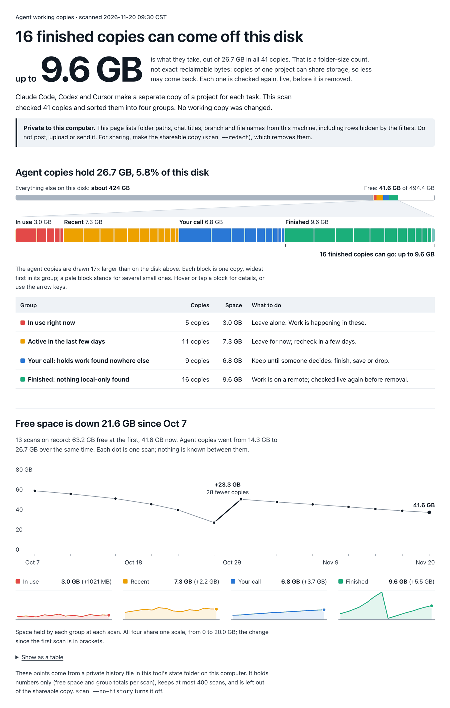
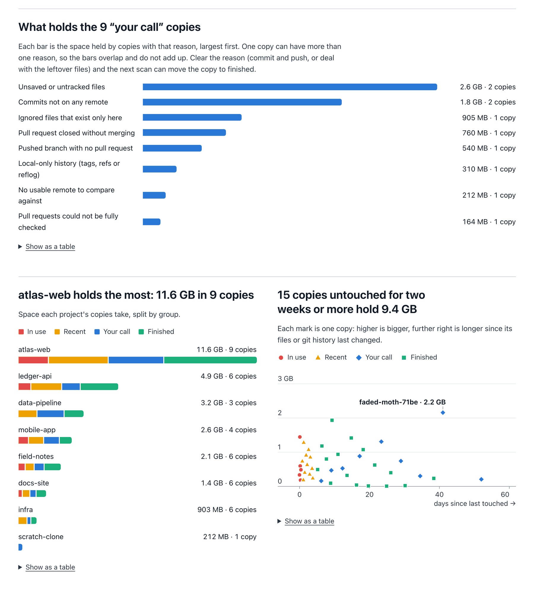
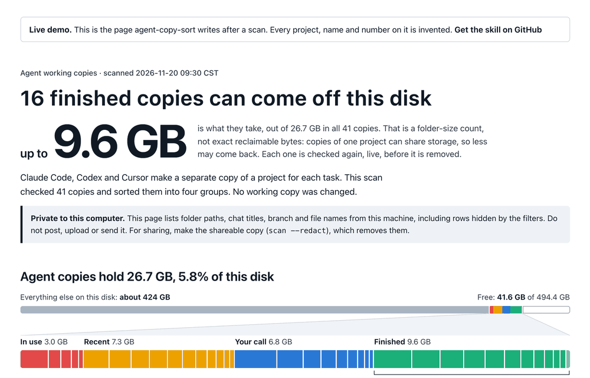
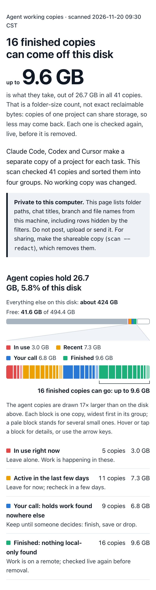
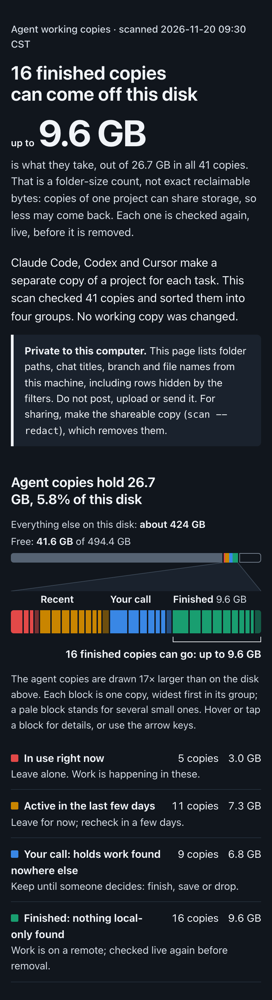

# agent-copy-sort

[](https://github.com/BTCElectrician/agent-copy-sort/actions/workflows/test.yml)

An agent skill that finds the extra copies of your code that Claude Code,
Codex and Cursor leave behind, tells you which ones are still being worked
on, and removes only the ones that are provably safe to remove, after you
say yes. It is written for Claude Code and Codex. Because it uses the open
[Agent Skills](https://agentskills.io/specification) format (`SKILL.md`),
other tools that read that format can load it too, though it has not been
exercised there.

## What you get

<picture>
  <source media="(prefers-color-scheme: dark)" srcset="docs/img/report-desktop-dark.png">
  
</picture>

**[Open the live demo](https://btcelectrician.github.io/agent-copy-sort/)** and
try it: hover a block, tap a dot on the chart, filter the tables. Every name
and number in it is invented.

Every scan writes this page. It answers one question first: what can I
safely remove, and how much space do I get back? Then it shows the disk drawn
to scale with the agent copies magnified (each block is one copy), free
space at each past scan, what is holding the copies that need your decision,
which projects pile up copies, and every copy in a table you can filter.

<picture>
  <source media="(prefers-color-scheme: dark)" srcset="docs/img/report-detail-dark.png">
  
</picture>



It is one self-contained file. It loads no fonts, scripts or images from
anywhere and makes no network requests. It works in light and dark, on a
phone and on a desktop, with a keyboard, and every chart has a table view.

<p>
  
  
</p>

The pictures above are the demo page: every project, name, path and number in
them is invented ([`demo/demo-scan.json`](demo/demo-scan.json)). Render it
yourself, without scanning anything:

```bash
python3 demo/render_demo.py --redact
```

The live demo is that same page with one line added at the top
(`docs/index.html`, rebuilt with `python3 demo/render_demo.py --site`; a test
fails if it falls behind the tool).

Two things the page is careful about. Sizes are folder sizes, not exact
reclaimable bytes: copies of one project can share storage, so the page says
"up to". And the free-space chart draws only scans that were actually run,
one dot each, from a small private history file (numbers only, at most 400
scans, `--no-history` turns it off); nothing is assumed between them.

## The problem

Coding agents give every task its own copy of your project so parallel work
does not collide: a git worktree under `.claude/worktrees/`,
`~/.codex/worktrees/` or `~/.cursor/worktrees/`, or a full clone in a temp
folder. Nothing cleans them up. After a few weeks you can have dozens of
copies, each with its own `node_modules` or virtual environment, and the disk
fills.

Deleting them by hand is risky. Some still hold work that exists nowhere
else: a commit that was never pushed, an untracked file, a `.env`, a branch
whose pull request was closed. Some are being used by an agent right now.
From the outside, a finished copy and an important one look the same.

## What it does

1. **Scan.** It finds the copies, then checks each one: is a program running
   inside it or holding a file open, is the chat that made it still active,
   does it hold anything local-only (unsaved, untracked or ignored files,
   unpushed commits or tags, history kept only by a reflog or `ORIG_HEAD`), and
   is its work already on a remote. It writes a private HTML page and a JSON
   plan that sort every copy into four groups: **in use**, **recently
   active**, **your call**, and **finished**. The scan changes no copy.
2. **You review.** Anything uncertain, or any check that failed, lands in
   "your call", never in "finished". The page says why for each copy. A
   `--redact` option writes a second page with paths, names, ids and the
   scan history removed if you need to share it.
3. **Remove what you approve.** `remove` takes the plan and the ids you
   approved. Without `--confirm` it is a dry run. With it, every copy is
   checked again from scratch right before acting, including a live
   `git ls-remote` against the remote, and once more after that slow step.
   Anything that is no longer finished is refused.

## What it will not do

- **It removes only fully safe copies.** Only copies in "finished" can be
  removed: nothing local-only found, and the work confirmed on the live
  remote. There is no force option. If you want to remove a "your call"
  copy, finish it properly (commit and push, or delete the specific leftover
  files yourself) and scan again.
- **Nothing may be writing to a copy while it is removed.** Stop the agent
  or program working there first. The checks before and after the slow
  steps catch most changes, but a write that lands between the last check
  and the deletion can be lost.
- **Removing a worktree is permanent; a clone goes to the Trash.** Linked
  worktrees are removed with plain `git worktree remove` (never `--force`);
  the folder does not go to the Trash, and its branch stays in the
  repository. Standalone clones are moved to the Trash (macOS `trash` or
  Finder, Linux `gio trash`), so you can still recover them there.
- It never removes your original repositories: anything found under your
  usual project folders or a `--root` you name is protected, as are main
  checkouts and repositories other copies depend on.
- It does not upload anything. The page, the plan and the scan history stay
  on your computer, in a folder only you can read, and the page itself makes
  no network requests. With `gh` installed it asks GitHub about pull
  requests; `--no-github` turns that off.
- It does not find copies outside the usual agent folders and temp folders.
  `--root` and `--temp-root` add more places to look.

## Platforms

Tested on macOS and Ubuntu Linux (GitHub Actions `macos-latest` and
`ubuntu-latest`) with the system Python 3 and git. It needs Python 3.9 or
newer and git, and nothing else outside the standard library. `gh`, `lsof`
and `tmutil` are used when present. Windows is not supported.

## Install

**Claude Code**

```bash
git clone https://github.com/BTCElectrician/agent-copy-sort.git ~/.claude/skills/agent-copy-sort
```

Claude Code picks up new skills without a restart; if `~/.claude/skills` did
not exist when the session started, run `/reload-skills`.

**Codex**

```bash
git clone https://github.com/BTCElectrician/agent-copy-sort.git ~/.agents/skills/agent-copy-sort
```

Codex still reads the older `~/.codex/skills`, but that location is
deprecated. If Codex does not list the skill, restart it.

To update later, run `git pull` in the folder you cloned into.

## Use

Ask your agent something like "my disk is full of agent worktrees, which
ones can go?" and the skill should trigger on its own. To call it
explicitly, use `/agent-copy-sort` in Claude Code or mention
`$agent-copy-sort` in Codex.

You can also run the script yourself:

```bash
# 1. Scan. Writes a private plan and page under ~/.local/state/agent-copy-sort
python3 ~/.claude/skills/agent-copy-sort/scripts/agent_copy_sort.py scan

# 2. Open the page it prints, read the four groups, pick finished copies.

# 3. Dry run, then the real removal, for the ids you chose
python3 ~/.claude/skills/agent-copy-sort/scripts/agent_copy_sort.py remove \
  --plan ~/.local/state/agent-copy-sort/scan-<stamp>.json --ids <id> <id>
python3 ~/.claude/skills/agent-copy-sort/scripts/agent_copy_sort.py remove \
  --plan ~/.local/state/agent-copy-sort/scan-<stamp>.json --ids <id> <id> --confirm
```

The scan prints a summary like this (abbreviated; numbers are illustrative):

```
23 copies: inuse 2 (1.4 GB), recent 5 (3.0 GB), decide 7 (6.2 GB), done 9 (11.8 GB)
plan: ~/.local/state/agent-copy-sort/scan-20260101-093000-1a2b3c.json
page (private, open locally): ~/.local/state/agent-copy-sort/report-20260101-093000-1a2b3c.html
```

[`SKILL.md`](SKILL.md) is the file the agent reads; it has the full
procedure, every option, and the complete list of what counts as
local-only.

## Tests

```bash
python3 -m unittest discover -s tests -v
```

Every test builds its repositories, remotes and chat records in a throwaway
temp folder with its own `HOME`; nothing outside it is scanned or removed.

## Repository layout

| Path | Purpose |
| --- | --- |
| `SKILL.md` | Instructions the agent loads when the skill triggers |
| `scripts/agent_copy_sort.py` | The scanner and remover (standard library only) |
| `tests/` | Tests, run on macOS and Linux in CI |
| `demo/` | An invented scan and a script that renders the report page from it |
| `docs/img/` | The pictures in this README, made from the demo page |
| `docs/index.html` | The live demo page |
| `.github/workflows/test.yml` | CI: tests on both platforms and a check against the Agent Skills spec |

## License

MIT. See [LICENSE](LICENSE).
